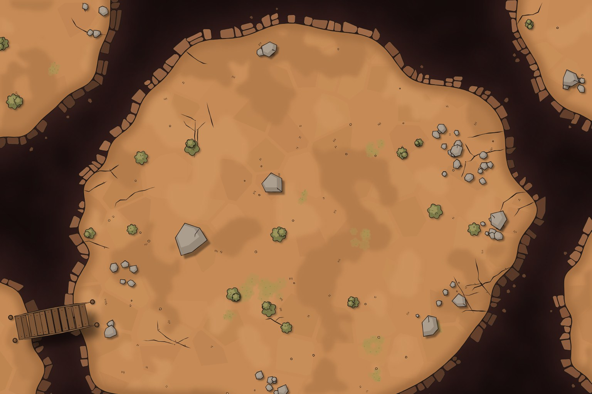
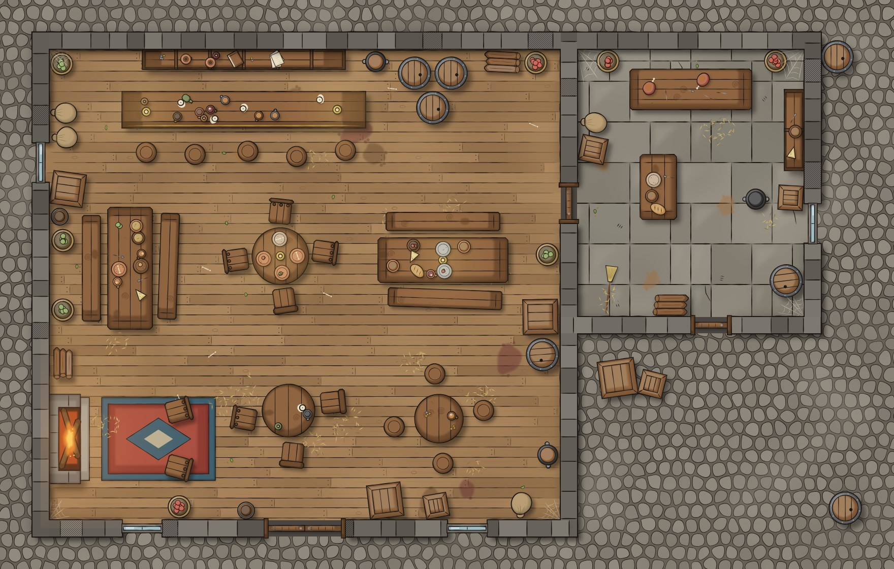
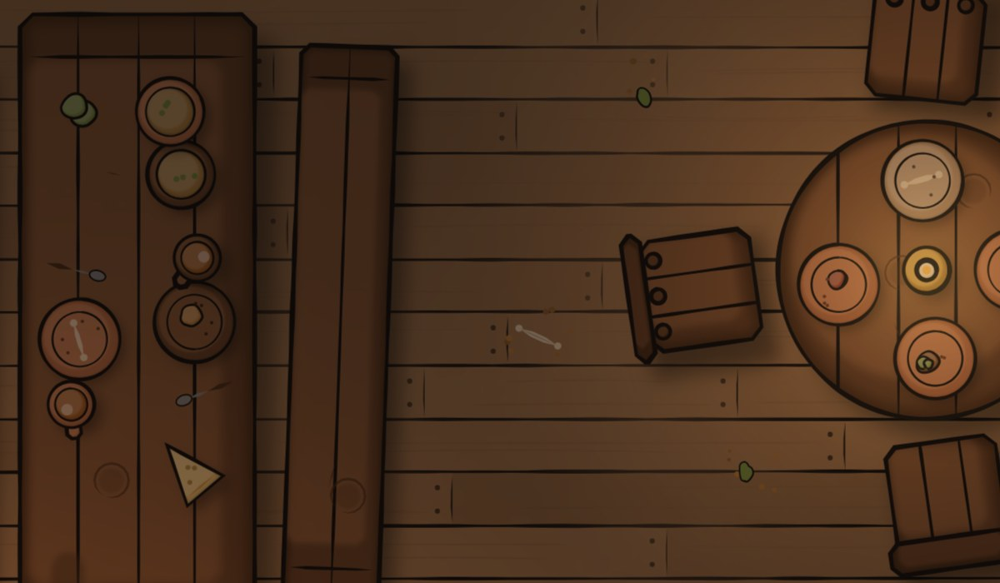
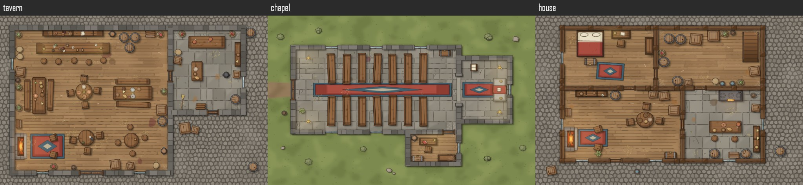
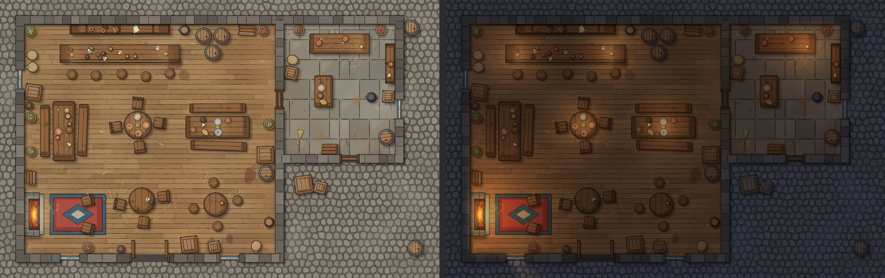
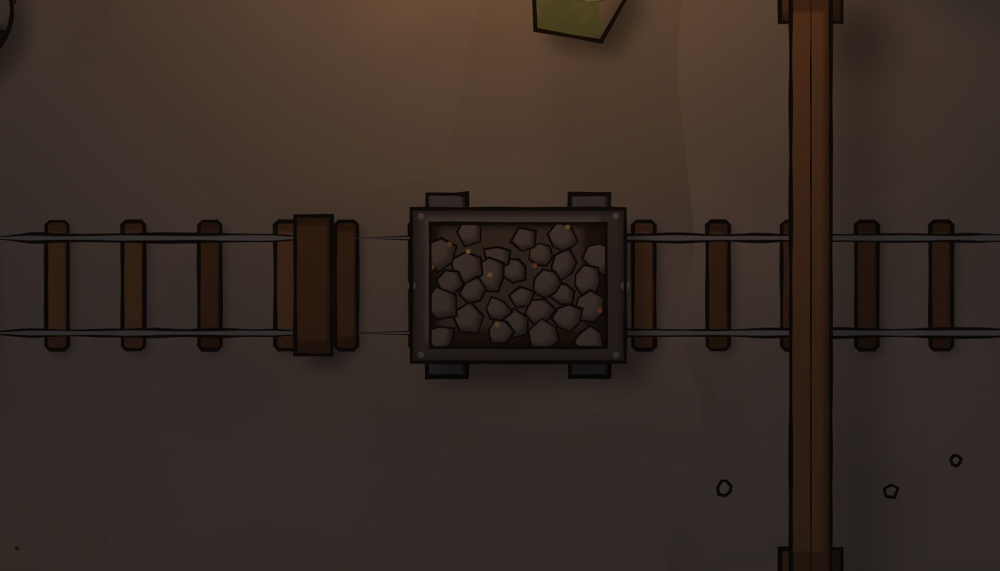
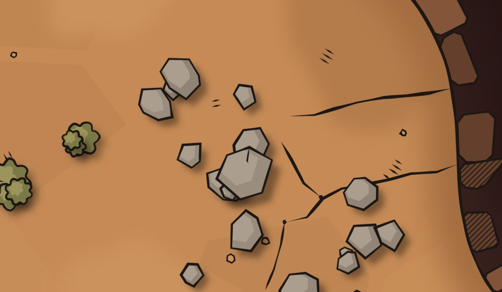
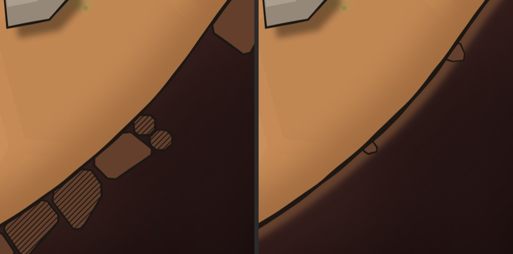
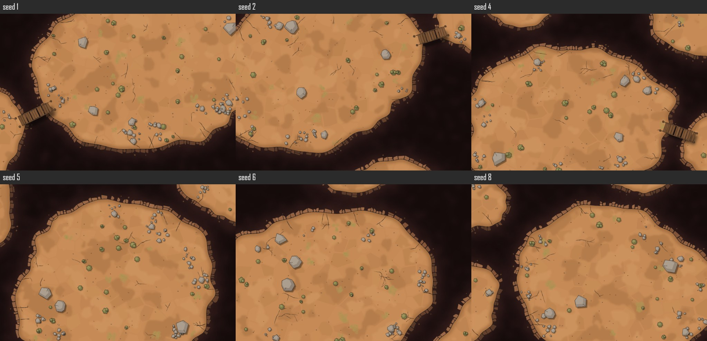
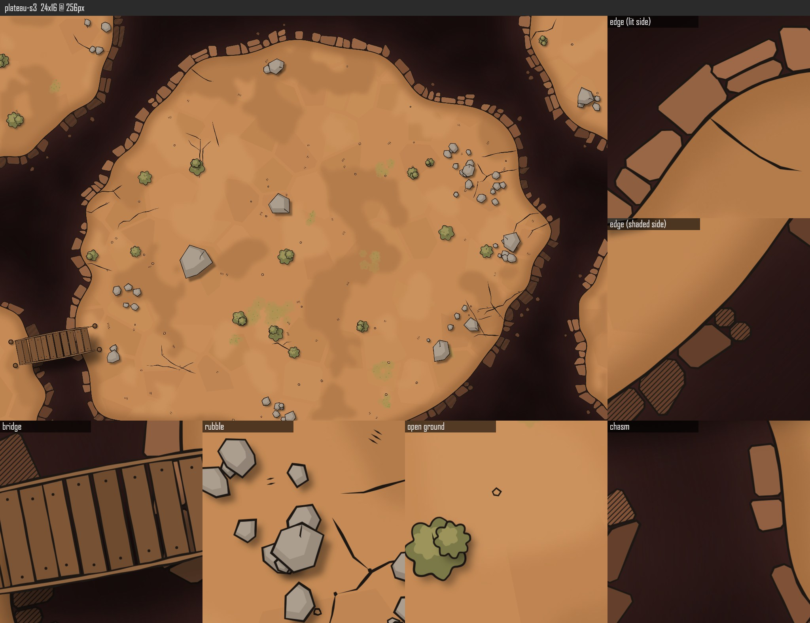

# MapGen

Hand-drawn-style D&D battle maps, made entirely in code: true top-down, an exact number
of pixels per 5 ft square, and reproducible from a seed.



MapGen is built to be run together with an AI coding agent (Claude Code). Describe a
map in a sentence and the agent writes it as a scene, renders it, looks at it through
a review sheet, judges it against a written style checklist, and fixes what's wrong,
the way an artist works from contact sheets.



## Why code instead of an image model

Image models are fine for region and town maps, but battle maps need things they don't
reliably give you:

- **A true top-down view.** Never isometric, never angled.
- **An exact scale.** A fixed number of pixels per square, so a virtual tabletop's grid
  lines up.
- **Precise, local edits.** "Widen that chasm" or "add a bridge here" without redrawing
  everything else.
- **Reproducibility.** The same seed always gives the same map.

## Maps from a description

> A two-room tavern on a cobbled street: bar along the north wall, hearth in the
> corner, a kitchen behind with a back door to an alley.

Type `/map` and a description like that in Claude Code. The `/map` skill
(`.claude/skills/map/`) plans the map on the grid and writes it as a **scene**: a
short, high-level `layout.json`, all in squares:

```json
{
  "type": "scene",
  "squares": [22, 14],
  "base": "cobbles",
  "rooms": [
    { "id": "hall", "rect": [1, 1, 14, 13], "floor": "wood", "wall": "stone" },
    { "id": "kitchen", "rect": [14, 1, 20, 8], "floor": "flagstone", "wall": "stone" }
  ],
  "openings": [
    { "kind": "double-door", "at": [7.5, 13] },
    { "kind": "door", "at": [14, 5] }
  ],
  "props": [
    { "kind": "bar", "at": [6, 2.7], "size": [6, 0.9], "dress": "drinks" },
    { "kind": "hearth", "at": [1.7, 10.8], "facing": "east" },
    { "kind": "table-round", "at": [6.9, 6.3], "dress": "meal" },
    { "kind": "chair", "at": [6.9, 5.2], "rotation": 6 }
  ],
  "dressing": [{ "kind": "stores", "in": "kitchen", "amount": 0.9 }]
}
```

Code works out the rest:

- **Walls**: rooms that share a wall line share one wall; corners and T-joins close
  up; doors, windows and archways are cut into whichever wall they sit on.
- **Props** come from a library of about a thousand kinds (see below), each drawn in
  the same hand.
- **Dressing** fills in the clutter from seeds: `"dress": "meal"` lays a table with a
  place setting in front of every chair (or `alchemy`, `arcane`, `workshop`, `maps`,
  `treasure`, `offerings`...); a room's `stores`, `litter` and `cobwebs` stack things
  along its walls, scatter the floor and web the corners, all clear of doorways and
  furniture. Give them a `setting` (`"mine"`, `"forge"`, `"docks"`...) and they pick
  what belongs there.
- **Lighting**: rooms are dim, with warm pools of light round every lamp, candle,
  hearth and brazier, stopped by walls and spilling out of open doors and windows.
- **Checks** run before anything is drawn: props in walls, blocked doorways, chairs
  inside tables, a candle not on a surface, a door that isn't on a wall. Each problem
  names the item and where it is.



The same skill made a tavern, a small chapel and a city house from one-line
descriptions (the scenes are in `scripts/samples/`):



### Light

A scene is lit for a time of day (`day`, `dusk`, `night` or `dark`). Each lamp, candle,
fire and glowing crystal throws a pool of light that falls off softly and stops at
walls and shut doors; windows let daylight in. The light is one soft layer multiplied
over the drawing, so the ink stays crisp.



### Any place, not just taverns

The prop library has about a thousand kinds from some four hundred objects, in 25
categories: furniture, containers, lighting, kitchen, books, tools, weapons, religious,
magic, nautical, mining, nature, structure, debris, textiles, market, camp, vehicles,
animals, prison, graveyard, farm and more. Most come in **families**: one drawing with
variants by material, contents and state, each its own kind (`crate-iron-open-ore`,
`chest-gilded-open-gems`, `barrel-lying-tapped`). Every one is drawn by code; the
list of what maps need came from surveying published asset catalogues for ideas
only (`docs/props-coverage.md`).


```sh
npm run props -- --search open crate     # find props; draws them on a sheet
npm run props -- --category magic        # one category
```

**Caves** are rooms with a rough rock face instead of a built wall. The skill made a
dwarven mine, a wizard's tower and a smugglers' sea cave from one-line descriptions:




When a map needs something the library doesn't have, `/map` uses the closest thing,
says so, and adds it to a wishlist; the `/prop` skill builds props from that list.

## How it works

Maps are made in two stages: a **scene** describes what's where, and a renderer draws
it. Scenes come from the `/map` skill or from a generator. The plateau generator
shows the generator side: it turns a seed into a scene.

1. **Generate a scene.** A seed becomes a `layout.json` describing everything that
   matters for play, measured in squares: plateau outlines (raised rock over a void),
   the bridge, cracks, and each stone, shrub and lichen patch. Generation follows tested rules: the main
   plateau covers 50–70% of the map with open chasm on at least two sides, neighbours
   sit across a real chasm, and a bridge always lands on rock at both ends.
2. **Render it.** A small drawing toolkit (`src/style/`) turns the scene into ink and
   flat colour: a tapered, slightly wobbling brush; soft tone steps; shadows from a
   single top-left light; and two edge styles. Everything is drawn in square units, so
   a map looks the same at 140 or 256 px per square.



Every item carries its own seed. Removing one stone, or moving a table with
everything on it, changes only the pixels around it, and the tests check it. That's
what makes precise edits safe.

**Two edge styles**, shared by every map: `blocks`, a broken lip of chunky stones
hatched on the shaded side, for hard rock edges; and `brushed`, a heavier ink line with
stones tucked under it, for edges that blend into their surroundings.



**Seeds vary the map, not the style:**



### The review loop

A full map is far too large to judge at a glance, so every render also writes a review
sheet: a scaled-down overview plus 1:1 crops of the places most worth inspecting. The
crops are picked from the layout, not at random: both sides of the edge, the bridge,
the busiest rubble, open ground and the chasm. The agent works from these sheets.



## Usage

Requires Node 22.4 or newer.

```sh
npm install
npm run render -- output/tavern/layout.json      # draw a scene (checks it first)
npm run props                                    # props per category, and a sheet of each
npm run props -- --search anvil                  # find props by name, use, setting or material
npm run map -- plateau --seed 7                  # 24x16 squares at 256 px per square
npm run map -- plateau --seeds 1-6 --px 128      # several, plus a contact sheet
npm run map -- plateau --seed 7 --edge brushed --bridge --squares 20x20
npm run map -- --help                            # every option
```

The scene format is documented in `.claude/skills/map/format.md`.

Each map gets its own folder under `output/`:

```
output/plateau-s7-24x16-256/
  plateau-s7.png     the map
  plateau-s7.json    grid sidecar for the tabletop app (same name as the map)
  layout.json        the scene, in squares, editable
  review.png         overview plus 1:1 crops, for judging the drawing
```

Grid lines are never drawn on the image. The sidecar tells the tabletop app where they
go:

```json
{
  "grid": { "square": 0.0416667, "origin": [0, 0], "lines": 0.5 },
  "source": { "generator": "plateau", "seed": 7, "squares": [24, 16], "px": 256 }
}
```

A scene's map and sidecar are named after it (`tavern.png`, `tavern.json`).

To change one thing without touching the rest, edit `layout.json` and redraw it:

```sh
npm run render -- output/plateau-s7-24x16-256/layout.json
```

The scene is checked first (nothing in a wall or hanging over the chasm, doorways
clear, bridges landing on rock), and nothing is drawn if there's a problem.

**MapGen only ever writes inside `output/`.** Every write goes through one guard that
refuses any other path, including `output/` itself being a symlink or junction to
somewhere else.

### Restyling with an image model

To try a different look without losing the layout, export it as flat shapes:

```sh
npm run restyle -- output/plateau-s7-24x16-256/layout.json
```

This writes `restyle.png` (every region, wall, door, prop and stone in a plain colour
that says what it is, about 2048 px wide) and `restyle-prompt.txt`, a
ready-to-paste prompt with the colour key and the rules: keep every shape, strictly
top-down, no grid lines. Give both to an image model along with a style reference.
The grid sidecar is in fractions of the image, so it still lines up with the result
as long as the proportions are kept.

## Development

```sh
npm run check    # typecheck, formatting and tests: green before every commit
```

The tests cover what matters without brittle pixel snapshots:

- layout rules, checked across many seeds and map sizes
- scene geometry: shared walls, joins, door cuts, facing
- the scene checks, each one breaking a sound scene on purpose
- dressing: always valid, and an added prop only removes what it lands on
- every prop draws inside its own footprint and shadow, at any turn
- lighting: light never crosses a wall or a shut door, and moving a lamp changes
  only the pixels it reaches
- caves: roughened from their seed, no props in the rock, light stopped by the face
- the grid sidecar maths, by placing grid lines from the sidecar alone
- pixel locality: editing one item changes only the pixels near it
- the output guard, including real junctions pointing outside `output/`
- the commands end to end, run in a sandbox inside `output/`

```
src/
  geometry.ts, rng.ts      polygon maths, seeded randomness with per-feature forks
  style/                   the drawing toolkit shared by every map
  battlemap/               grid, sidecar, review sheets
    scene/                 the scene format, resolver, checks, dressing, renderer
      props/               the prop library: families by category, catalogue, search
    plateau/               the plateau generator, which outputs a scene
  cli/                     map, render, restyle and props commands, and the output guard
.claude/skills/map/        the /map skill and the scene format reference
.claude/skills/prop/       the /prop skill, for adding props
docs/                      how the prop library scales, and the coverage list
scripts/readme-images.ts   makes the images in this README
scripts/samples/           the sample scenes shown here
```

The README images come from `npx tsx scripts/readme-images.ts`, which writes to
`output/readme/`; they're then copied into `docs/images/` by hand.

## License

[MIT](LICENSE)
